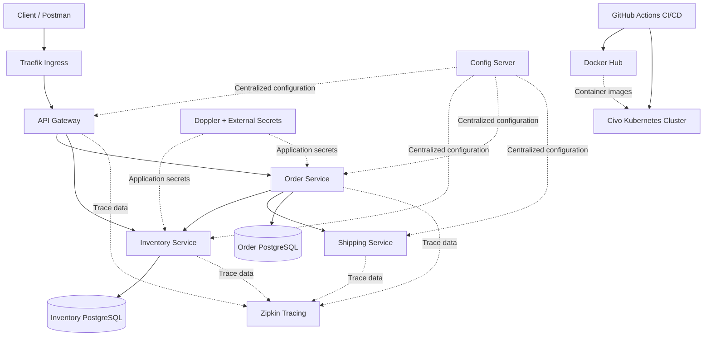

# Week 17 — Kubernetes Advanced: eCommerce Microservices

This project is part of my Spring Boot learning journey. In this week, I worked on deploying an eCommerce microservices application to Kubernetes and understanding how different services communicate, how databases store data, how application configuration and secrets are managed, and how deployments can be automated using GitHub Actions.

The main goal of this project is to understand how a Spring Boot microservices application can run in a Kubernetes cluster instead of running only on my local machine.

## Table of Contents

- [Project Overview](#project-overview)
- [Project Objectives](#project-objectives)
- [Architecture Overview](#architecture-overview)
- [Application Services](#application-services)
- [How the Application Works](#how-the-application-works)
- [Kubernetes Implementation](#kubernetes-implementation)
- [CI/CD Pipeline](#cicd-pipeline)
- [Technology Stack](#technology-stack)
- [Project Structure](#project-structure)
- [Testing and Verification](#testing-and-verification)
- [Important Notes](#important-notes)
- [What I Learned](#what-i-learned)

## Project Overview

The eCommerce application is built using Spring Boot microservices. Instead of keeping all the application functionality inside one large application, the project separates responsibilities into multiple services.

Each service runs as a separate application inside Kubernetes. Kubernetes helps manage these applications, restart containers when necessary, provide networking between services, and maintain the desired number of running replicas.

For this project, I used **Civo Kubernetes** to deploy and run the application. I also worked with PostgreSQL databases, Kubernetes StatefulSets, persistent storage, Config Server, Kubernetes DNS, Ingress, secrets management, and GitHub Actions CI/CD.

The project follows the concepts covered in the advanced Kubernetes module, with the final implementation adapted to the Civo Kubernetes environment.

## Project Objectives

The main objectives of this project are:

- Deploy Spring Boot microservices inside a Kubernetes cluster.
- Understand Kubernetes Deployments, Services, StatefulSets, and PersistentVolumeClaims.
- Configure communication between microservices using Kubernetes DNS.
- Expose application endpoints through Kubernetes Ingress.
- Manage application configuration using Spring Cloud Config Server.
- Manage sensitive configuration using Doppler and External Secrets.
- Store application data in PostgreSQL databases with persistent storage.
- Automate application builds and Kubernetes deployments using GitHub Actions.
- Test the deployed application using Postman and verify database records.

## Architecture Overview

The application contains five main application services, two PostgreSQL database workloads, a central configuration service, and Zipkin for distributed tracing.

The API Gateway acts as the entry point for client requests. The application services communicate through Kubernetes Services and DNS rather than depending on Eureka for service discovery.

### Architecture Diagram



The diagram represents the main architecture and intended communication paths. The exact services involved in a request depend on the API endpoint being called.

## Application Services

| Service | Responsibility |
|---|---|
| API Gateway | Entry point for client requests, routing, and configured authentication and authorization filters. |
| Config Server | Provides centralized configuration to Spring Boot services. |
| Inventory Service | Manages product inventory and communicates with the inventory PostgreSQL database. |
| Order Service | Handles order-related operations and communicates with the order PostgreSQL database. |
| Shipping Service | Handles shipping-related functionality. |
| Zipkin | Collects distributed tracing information to help inspect requests across services. |

The application services run as separate Kubernetes workloads. Kubernetes Services provide stable network names and ports, allowing applications to communicate without depending on the changing IP addresses of individual Pods.

## How the Application Works

A typical request follows these steps:

1. A client sends an HTTP request using Postman or another client.
2. The request reaches the application through the Traefik Ingress endpoint.
3. Traefik forwards the request to the API Gateway.
4. The API Gateway applies its configured filters and routes the request to the appropriate application service.
5. The target service processes the request and communicates with other services or its database when required.
6. The response travels back through the relevant service and gateway to the client.

For example, when creating an order, the client sends a request through the Gateway to the Order Service. The Order Service processes the order according to the application's implementation and may interact with other services as required.

The exact flow depends on the endpoint and the business logic implemented in the application.

## Kubernetes Implementation

### 1. Kubernetes Deployments

The API Gateway, Config Server, Inventory Service, Order Service, Shipping Service, and Zipkin run as Kubernetes workloads.

Deployments manage the application Pods and help maintain the desired number of running instances.

### 2. Kubernetes Services and DNS

Kubernetes Services provide stable network endpoints for application workloads.

For example, the Order Service can be reached inside the cluster using its Kubernetes Service name and port:

```text
http://order-service:9021
```

The Config Server is available internally at:

```text
http://config-server:8888
```

The application uses Kubernetes DNS for service-to-service communication. Eureka-based service discovery is not required for the deployed Kubernetes setup.

The Spring profile used for the Kubernetes environment is:

```text
SPRING_PROFILES_ACTIVE=k8s
```

### 3. PostgreSQL and Persistent Storage

The Inventory and Order services use PostgreSQL databases.

The databases run using Kubernetes StatefulSets, with persistent storage configured through PersistentVolumeClaims. This allows database storage to be managed independently of the lifecycle of application Pods.

Persistent storage is important because application restarts or Pod replacement should not automatically mean that the database files are lost.

### 4. Ingress

Traefik is used as the Kubernetes Ingress controller to expose application endpoints outside the cluster.

Ingress rules route incoming HTTP requests to the appropriate Kubernetes Services. This provides an external entry point without requiring every application service to be exposed separately.

### 5. Configuration and Secrets

Spring Cloud Config Server provides centralized application configuration.

Kubernetes ConfigMaps store non-sensitive configuration, while sensitive values such as database credentials are managed through the configured secrets-management workflow using Doppler and External Secrets.

Credentials and access tokens should not be committed to the GitHub repository.

### 6. Distributed Tracing

Zipkin is included to inspect distributed requests across the application services.

Distributed tracing helps identify which services participate in a request and makes it easier to investigate latency and communication problems.

## CI/CD Pipeline

GitHub Actions is used to automate the build and deployment process.

The general pipeline works as follows:

1. Code changes are committed and pushed to GitHub.
2. GitHub Actions runs the configured workflow.
3. Maven builds the application services.
4. Jib builds and publishes the configured container images to Docker Hub.
5. The workflow updates the corresponding Kubernetes workloads in the Civo cluster.
6. Kubernetes pulls the updated images and runs the new application versions.
7. Deployment status and application behavior are verified.

The CI/CD workflow covers these five application services:

- API Gateway
- Config Server
- Inventory Service
- Order Service
- Shipping Service

The Discovery Service is not included in the deployment workflow because the Kubernetes setup uses Kubernetes DNS for service communication.

## Technology Stack

| Technology | Purpose |
|---|---|
| Java 21 | Programming language and runtime |
| Spring Boot | Building the microservices |
| Spring Cloud Config | Centralized application configuration |
| Spring Cloud Gateway | API routing and configured gateway filters |
| PostgreSQL | Relational database |
| Maven | Project build and dependency management |
| Docker and Jib | Container image creation and publishing |
| Kubernetes | Container orchestration |
| Civo Kubernetes | Managed Kubernetes environment |
| Traefik | Ingress and external request routing |
| Kubernetes StatefulSets and PVCs | Database workloads and persistent storage |
| Doppler and External Secrets | Secrets management and synchronization |
| GitHub Actions | CI/CD automation |
| Docker Hub | Container image registry |
| Postman | API testing |
| Zipkin | Distributed tracing |

## Project Structure

The main project is maintained inside my Spring Boot learning repository.

```text
spring-boot-learning/
└── week-17-Kubernetes-Advanced/
    └── eCommerce/
        ├── api-gateway/
        ├── config-server/
        ├── inventory-service/
        ├── order-service/
        ├── shipping-service/
        ├── k8s/
        ├── .github/
        │   └── workflows/
        │       └── buildanddeploy.yml
        └── README.md
```

This is a simplified view of the project structure. The exact files and folders may vary depending on the configuration and deployment manifests maintained in the repository.

## Testing and Verification

After deploying the application, I used Postman to test the API endpoints.

The verification process included:

- Requesting an access token through the configured authentication endpoint.
- Sending an authenticated Create Order request.
- Checking the API response.
- Querying PostgreSQL to verify that expected records were stored.
- Checking Kubernetes Deployments and Pods to verify application health.
- Verifying the CI/CD workflow completed successfully.

These checks help confirm that the project is running in Kubernetes and that the application, database, and deployment workflow work together.

## Important Notes

- The final deployment environment for this project is Civo Kubernetes, not Google Kubernetes Engine.
- Kubernetes DNS is used instead of Eureka-based service discovery in the deployed setup.
- The `k8s` Spring profile is used for Kubernetes-specific configuration.
- Application secrets and database credentials must be supplied through the configured secrets-management process.
- Persistent storage is configured for the PostgreSQL workloads.
- The live cluster and ingress endpoint may not remain available after the demonstration because cloud resources can be stopped or deleted to control costs.
- Configuration names, ports, and deployment details should match the current Kubernetes manifests and application configuration in the repository.

## What I Learned

Through this project, I gained practical experience with:

- Deploying Spring Boot microservices on Kubernetes.
- Using Kubernetes Services and DNS for internal communication.
- Running PostgreSQL using StatefulSets and persistent storage.
- Exposing applications through Ingress.
- Managing centralized configuration and application secrets.
- Automating container image publishing and Kubernetes deployments.
- Testing APIs and verifying database persistence.
- Understanding how multiple services work together in a distributed application.

This project helped me understand how the concepts learned in Spring Boot and microservices can be applied to a real Kubernetes deployment and automated delivery workflow.
